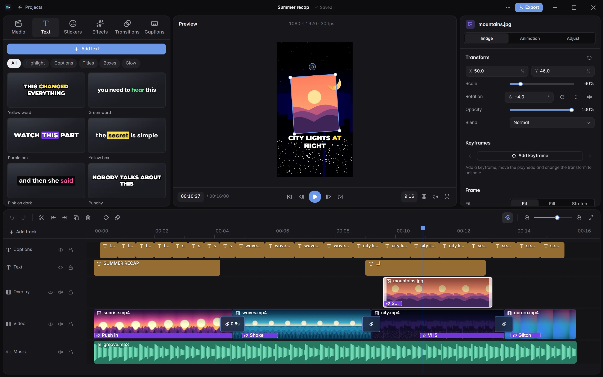
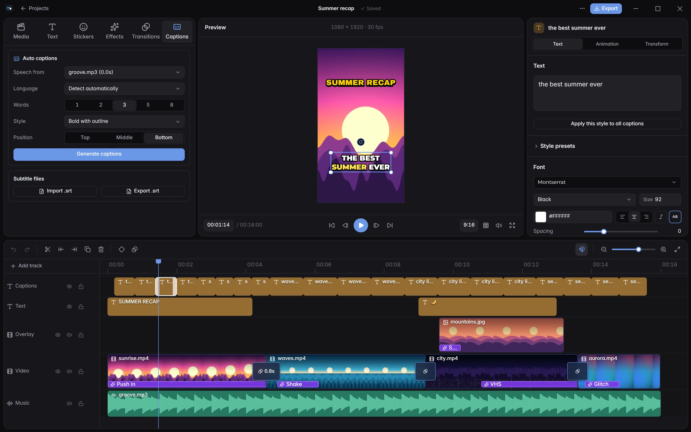
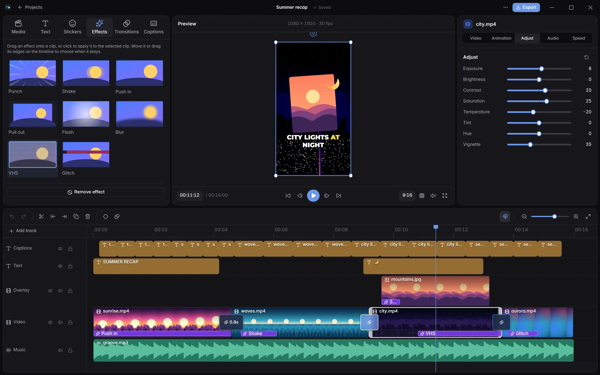

<div align="center">


# ViralFlow

Free, open-source alternative to CapCut.<br>
Native, lightweight & fast.

[](https://github.com/ivall/viralflow/actions/workflows/ci.yml)
[](https://github.com/ivall/viralflow/releases)
[](LICENSE)

<br>




</div>

## Features

- Multi-track timeline with video, photos, text, stickers and audio.
- Move, scale and rotate anything right on the preview, with keyframes for animation.
- Auto captions with word-by-word timing, generated locally with Whisper, with styles that light up each spoken word.
- Transitions and effects you drag onto the timeline and stretch to length, plus in/out animations and color correction.
- Text styles made for short-form video, with custom fonts, outlines, boxes, glows and shadows.
- Export to MP4, MOV or WebM up to 4K, with GPU encoding (NVIDIA, AMD, Intel, Apple), voice cleanup and loudness normalisation.
- Smooth preview: frames are decoded ahead of the playhead (on the GPU for HEVC, AV1 and 4K footage), and what you hear while editing is exactly what gets exported.
- Your work is safe: autosave, a backup of the previous save, and projects that still open when a file is damaged or was saved by a newer version.
- Optional AI tools through your own OpenRouter key: rewrite text, cloud captions and auto-edit voiceovers with your photos.
- Windows, macOS and Linux.

<table>
  <tr>
    <td width="40%"></td>
    <td width="40%"></td>
    <td width="20%"></td>
  </tr>
  <tr>
    <td align="center"><sub>Captions</sub></td>
    <td align="center"><sub>Effects and color</sub></td>
    <td align="center"><sub>Exported result</sub></td>
  </tr>
</table>

## Install

Grab the latest build from [Releases](https://github.com/ivall/viralflow/releases). FFmpeg is
included everywhere, nothing else to install.

| System | Download |
| --- | --- |
| Windows 10/11 | `ViralFlow-…-setup.exe` (installer) or the portable `.zip` |
| macOS (Apple silicon / Intel) | `ViralFlow-…-macos-arm64.dmg` / `-x86_64.dmg` |
| Linux (x64 / arm64) | `ViralFlow-…-linux-x86_64.AppImage` (`chmod +x`, run) or the `.tar.gz` |

Builds aren't code-signed yet: Windows SmartScreen may ask for confirmation, and on macOS open the
app the first time with right-click → *Open*. Local Whisper captions need FFmpeg's `whisper` filter,
which the bundled Windows build has; on macOS and Linux use cloud captions (OpenRouter).

Projects and settings of earlier (Tauri) versions open unchanged.

## How it works

ViralFlow is a native Rust app. The interface is [Slint](https://slint.dev); the preview and the
export are rendered by the same [wgpu](https://wgpu.rs) compositor, so what you see is what you
export, and the sound comes from one mixer for both (pitch-preserving speed changes, voice
cleanup, BS.1770 loudness and a limiter). Media is decoded and encoded by FFmpeg's libraries inside
the app (no command-line tools), on the GPU where that is faster, and speech recognition runs
through whisper.cpp in FFmpeg's `whisper` filter.

The preview keeps a memory-bounded cache of decoded frames filled ahead of the playhead, so
playback shows every frame on time and scrubbing back over what you just watched is instant.
Projects are plain JSON (`project.json` per project, saved atomically with a backup); unknown
fields are kept, so files from newer versions round-trip. See [docs/ARCHITECTURE.md](docs/ARCHITECTURE.md)
for how the pieces fit together.

| Crate | What it does |
| --- | --- |
| `crates/vf-core` | Project model, editing operations with undo, animation and timeline rules |
| `crates/vf-media` | Probing, decoding, filters and encoding through libav |
| `crates/vf-render` | GPU compositor (effects, blend modes, blur) and text rendering |
| `crates/vf-audio` | One mix for preview and export: tempo, voice cleanup, loudness (BS.1770) and limiter |
| `crates/vf-ai` | Whisper captions, caption timing and the OpenRouter client |
| `app` | The Slint application |

## Build from source

Requires stable Rust, libclang (for the FFmpeg bindings) and an FFmpeg 8 **shared** build with
headers (FFmpeg 9 is not supported yet).

**Windows:** `winget install LLVM.LLVM` and the "full_build-shared" FFmpeg 8 package from
[gyan.dev](https://www.gyan.dev/ffmpeg/builds/). By default the build looks in
`C:\Program Files\ffmpeg` and `C:\Program Files\LLVM` (see `.cargo/config.toml`); set `FFMPEG_DIR` /
`LIBCLANG_PATH` for other folders. FFmpeg's `bin` folder must be on `PATH` to run a development build.

```sh
cargo run -p viralflow
pwsh scripts/package.ps1              # .zip and (with Inno Setup 6) the installer in dist/
```

**Linux** (Ubuntu/Debian package names):

```sh
sudo apt install clang libclang-dev pkg-config libxkbcommon-dev libfontconfig1-dev libasound2-dev libdbus-1-dev libwayland-dev
bash scripts/ci/ffmpeg-linux.sh       # FFmpeg 8 shared build into ./ffmpeg-download
export FFMPEG_DIR=$PWD/ffmpeg-download PKG_CONFIG_PATH=$PWD/ffmpeg-download/lib/pkgconfig LD_LIBRARY_PATH=$PWD/ffmpeg-download/lib
cargo run -p viralflow
bash scripts/package-linux.sh         # AppImage and .tar.gz in dist/
```

**macOS:**

```sh
brew install ffmpeg@8 pkg-config dylibbundler
export FFMPEG_DIR=$(brew --prefix ffmpeg@8) PKG_CONFIG_PATH=$(brew --prefix ffmpeg@8)/lib/pkgconfig
cargo run -p viralflow
bash scripts/package-macos.sh         # .dmg and .zip in dist/
```

GPU video decoding is on by default on Windows (D3D11VA) and macOS (VideoToolbox); on Linux VAAPI is
opt-in with `VF_VAAPI=1`. `VF_HWDECODE=off` turns it off everywhere.

Pushing a version tag that matches `version` in `Cargo.toml` (`git tag v1.0.0 && git push origin v1.0.0`)
builds every installer on GitHub Actions and attaches them to a draft release.

## Privacy

Everything runs on your computer: media, projects and local Whisper captions never leave it. The
app goes online only when you ask it to: to download a Whisper speech model (from Hugging Face),
and for the AI tools, which are off until you add your own [OpenRouter](https://openrouter.ai)
key. Only what you send to them (text, the clip's audio, photos for auto-edit) is uploaded. The
key is kept in the system credential store.

## Contributing

Issues and pull requests are welcome. Before sending a change, run the same checks as CI:

```sh
cargo fmt --all --check && cargo clippy --workspace --all-targets -- -D warnings && cargo test --workspace
```

The UI tests run headless (no window opens); media tests make their fixtures with the `ffmpeg`
command line when it is installed and are skipped otherwise.

## License

[GPL-3.0](LICENSE). FFmpeg is distributed under the GPL with the app. Bundled fonts are under the
SIL Open Font License, see [`assets/licenses`](assets/licenses/FONTS.md).
